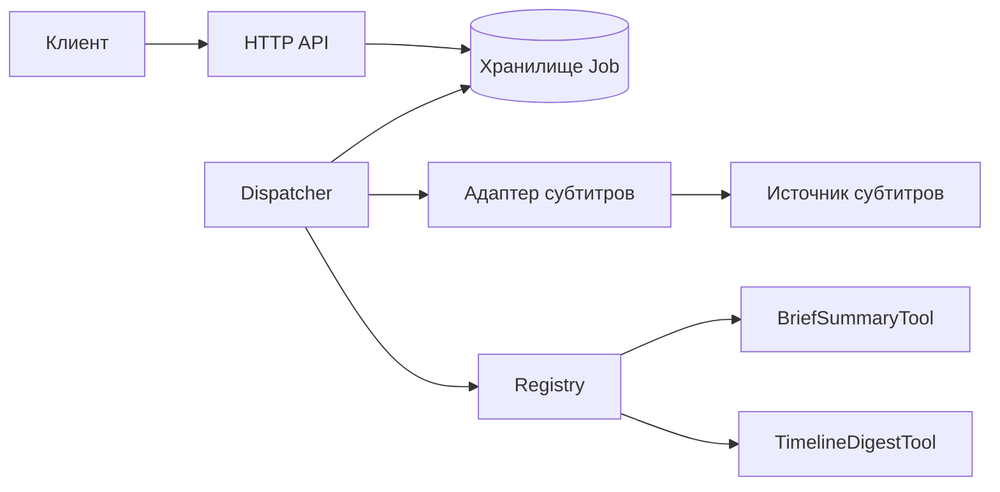
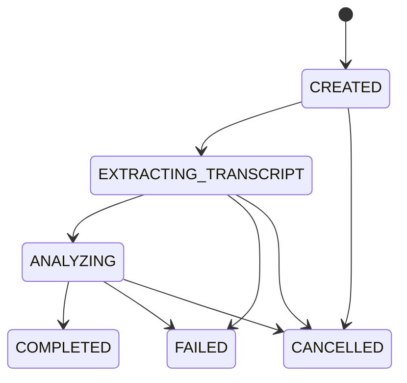

# Контракт API пересказа YouTube-роликов

Контракт первой версии дополняет [сценарии и критерии приёмки](requirements.md). API принимает ссылку на общедоступный ролик YouTube, получает субтитры и возвращает краткий пересказ или таймлайн.

## Компоненты



Dispatcher забирает сохранённую Job, получает субтитры через адаптер и выбирает Tool по режиму через Registry.

## Создание Job

`POST /jobs` принимает JSON и обязательный заголовок `Idempotency-Key` длиной от 1 до 128 символов из набора `A–Z`, `a–z`, `0–9`, `-`, `_`. Все запросы требуют токен клиента в `Authorization: Bearer <token>`. Отсутствующий или недействительный токен даёт `401 UNAUTHORIZED` с заголовком `WWW-Authenticate: Bearer`.

```json
{
  "url": "https://www.youtube.com/watch?v=abcdefghijk",
  "operation": "timeline"
}
```

- `url` — обязательная строка до 2048 символов. Поддерживаются HTTPS-ссылки `www.youtube.com/watch?v=<id>` и `youtu.be/<id>`. Идентификатор состоит из 11 букв латинского алфавита, цифр, дефисов или подчёркиваний. Дополнительные параметры ссылки игнорируются. Адаптер получает идентификатор ролика.
- `operation` — строка `brief` или `timeline`. При отсутствии поля используется `brief`.
- Успешное создание возвращает `202 Accepted`, заголовок `Location: /jobs/<id>` и тело `{"id":"<id>","status":"CREATED"}`.

Клиент назначает ключ один раз на действие и использует его для всех повторов этого действия. Ключ действует в пределах клиента и хранится вместе с Job. Создание Job и привязка ключа выполняются атомарно. Повтор с тем же ключом, идентификатором ролика и режимом возвращает исходные `202`, `Location` и тело, даже если статус уже изменился. Актуальный статус доступен по `Location`. При том же ключе и другом ролике или режиме API возвращает `409 IDEMPOTENCY_CONFLICT`. Новый ключ создаёт новую Job, в том числе после завершения предыдущей. Прежний результат остаётся доступным по прежнему ID.

## Чтение и отмена

`GET /jobs/{id}` возвращает `200 OK` с `id` и `status`. В состоянии `COMPLETED` добавляется `result`, в `FAILED` — `error` с полями `code` и `message`. В остальных состояниях оба поля отсутствуют.

- Для `brief` результат содержит `points`, непустой массив строк.
- Для `timeline` результат содержит `segments`, непустой массив объектов с `startMs` и непустым массивом строк `points`. Время начала берётся из субтитров в миллисекундах. Отрезки отсортированы по времени начала.

`POST /jobs/{id}/cancel` атомарно переводит активную Job в `CANCELLED` и возвращает `200 OK` с `id` и `status`. Повторная отмена возвращает тот же ответ. Для `COMPLETED` или `FAILED` API возвращает `409 JOB_ALREADY_FINISHED`. Если завершение и отмена происходят одновременно, выигрывает первый сохранённый переход. После отмены промежуточные данные отбрасываются, запоздавший ответ адаптера не запускает Tool, а ответ уже запущенного Tool не сохраняется.

Чтение и отмена чужой или отсутствующей Job возвращают одинаковый `404 JOB_NOT_FOUND`.

## Ошибки запроса

Ошибки API имеют форму `{"error":{"code":"INVALID_FIELD","message":"Ожидалась строка","field":"operation"}}`. Поле `field` добавляется для ошибки конкретного поля или заголовка. Ошибки создания не создают Job.

| HTTP | Код | Условие |
|---|---|---|
| 400 | `INVALID_JSON` | Тело невозможно разобрать как JSON |
| 413 | `REQUEST_TOO_LARGE` | Тело превышает 16 КиБ, проверка идёт до разбора JSON |
| 415 | `UNSUPPORTED_MEDIA_TYPE` | Для создания указан тип тела, отличный от `application/json`, или тип отсутствует |
| 422 | `INVALID_FIELD` | Тело не объект, поле пропущено, имеет неверный тип или формат, передано лишнее поле либо отсутствует или некорректен ключ |
| 422 | `UNSUPPORTED_OPERATION` | `operation` содержит неизвестную строку |

## Состояния и сбои



Job и её состояние сохраняются в хранилище. Исполнитель получает право обрабатывать Job на 60 секунд и продлевает его каждые 15 секунд. При старте Dispatcher и затем каждые 15 секунд проверяет просроченные права. Job в `CREATED` доступны для запуска. Job в `EXTRACTING_TRANSCRIPT` или `ANALYZING` с просроченным правом переводятся в `FAILED` с кодом `PROCESSING_INTERRUPTED`. Переходы по результатам обработки принимаются только от исполнителя с действующим правом. Запоздавшие ответы не меняют конечное состояние.

Адаптер ждёт ответ до 10 секунд и делает одну повторную попытку при таймауте. На этапе получения субтитров применяются следующие правила.

| Ситуация | Итог |
|---|---|
| Ролик недоступен или источник сообщает об отсутствии субтитров | `FAILED / TRANSCRIPT_UNAVAILABLE` |
| Обе попытки завершились по таймауту | `FAILED / TRANSCRIPT_TIMEOUT` |
| Источник недоступен и возвращает ошибку | `FAILED / TRANSCRIPT_SOURCE_ERROR` |
| Ответ нарушает ожидаемую схему, например пропало обязательное поле таймкода | `FAILED / TRANSCRIPT_INVALID_RESPONSE` |
| Ответ с субтитрами превышает 2 МиБ после распаковки | Адаптер прекращает чтение и сохраняет `FAILED / TRANSCRIPT_TOO_LARGE` |

При этих сбоях Tool не запускается. Если Tool завершился ошибкой, Job переходит из `ANALYZING` в `FAILED` с кодом `ANALYSIS_FAILED`. Клиент узнаёт причину через `GET /jobs/{id}`.

## Проверка по картам покера

| Карта | Запрос или событие | Ответ и состояние Job |
|---|---|---|
| К1 Двойной клик | Два `POST /jobs` с одинаковым ключом и телом через 100 мс | Оба получают `202` с одним ID. Создаётся одна Job. |
| К2 Ответ потерялся | Первый `202` потерян после записи Job | Повтор с тем же ключом возвращает исходный ID. Клиент читает актуальный статус по `Location`. |
| К3 Неизвестная операция | `operation: "translate"` | `422 UNSUPPORTED_OPERATION`, поле `operation`. Job отсутствует. |
| К4 Кривые параметры | Нет `url`, либо `operation` равно числу | `422 INVALID_FIELD` с именем ошибочного поля. Job отсутствует. |
| К5 Воскрешение | Отправили те же параметры после `COMPLETED` или `FAILED` | Старый ключ даёт прежний ID. Новый ключ даёт `202` с новым ID и статусом `CREATED`. |
| К6 Отмена | Отмена во время анализа, затем Tool вернул тезисы | `200` и `CANCELLED`, тезисы не сохраняются. |
| К7 Огромный вход | Тело запроса размером 1 МиБ или субтитры размером 3 МиБ | В первом случае `413 REQUEST_TOO_LARGE` без Job. Во втором Job переходит в `FAILED / TRANSCRIPT_TOO_LARGE`. |
| К8 Чужой или несуществующий ID | Попытка чтения или отмены по такому ID | Одинаковые `404 JOB_NOT_FOUND` и тело ошибки. Состояние чужой Job не меняется. |
| К9 Перезапуск | Dispatcher остановился в `ANALYZING` | После истечения права обработки проверка переводит Job в `FAILED / PROCESSING_INTERRUPTED`. |
| К10 Внешний сервис | Источник молчит 30 секунд или прислал субтитры без таймкодов | В первом случае после двух таймаутов `FAILED / TRANSCRIPT_TIMEOUT`. Во втором `FAILED / TRANSCRIPT_INVALID_RESPONSE`. |
| Джокер | Два параллельных запроса с одним ключом, один с `brief`, другой с `timeline` | Один запрос создаёт Job и получает `202`. Другой получает `409 IDEMPOTENCY_CONFLICT`. |
