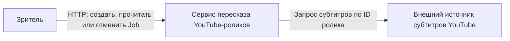
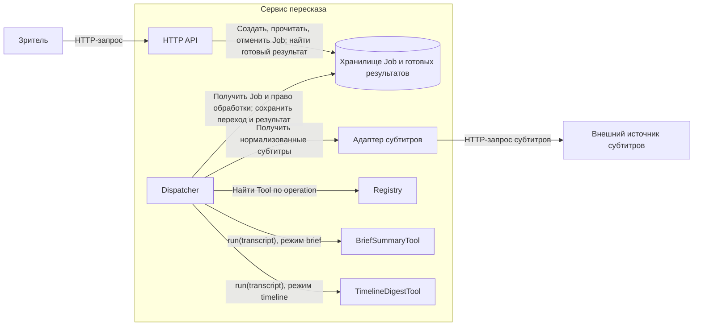
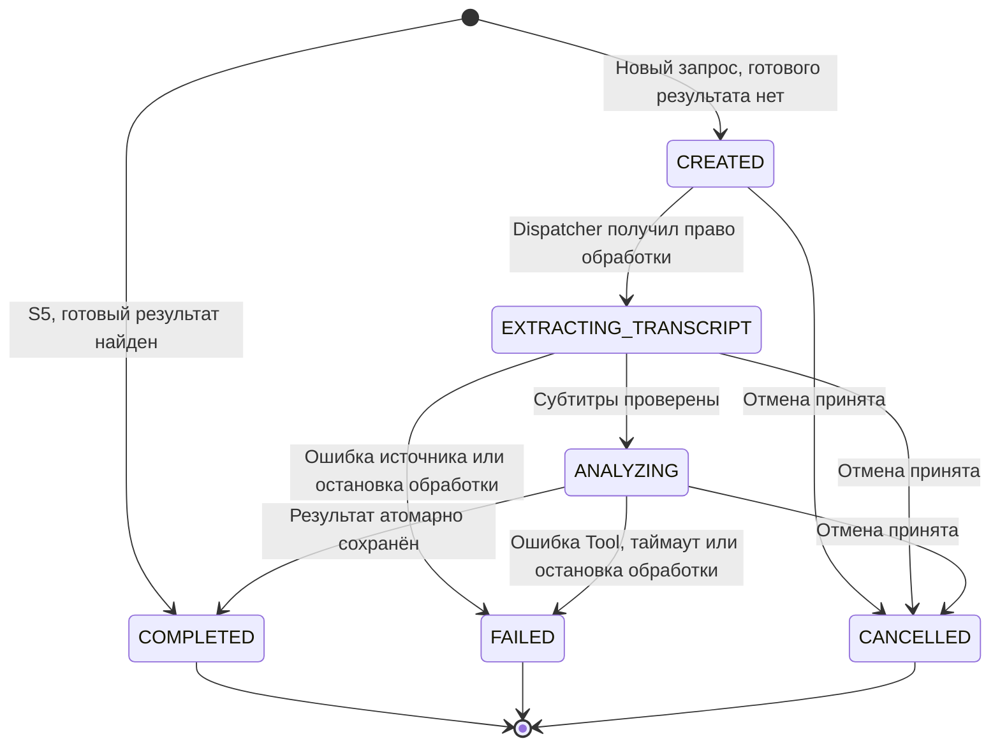

# Архитектура сервиса пересказа роликов

Документ покрывает пункты 1–2 практики 2 и опирается на [сценарии S1–S5](requirements.md). Внешний источник субтитров доступен через адаптер. Конкретного поставщика предстоит выбрать.

## Контекст

Стрелки показывают вызовы во время работы. Ответы с результатами и ошибками возвращаются по тем же каналам в обратную сторону. Хранение Job, обработка и кэш готовых результатов находятся внутри границы сервиса.

## Компоненты

Стрелки показывают вызовы во время работы. Registry возвращает Dispatcher ссылку на выбранный Tool. Dispatcher вызывает этот Tool через общий контракт. Ответ HTTP о создании Job возвращается после сохранения Job, обработка продолжается в фоне.

| Компонент | Ответственность | Что скрывает от соседей |
|---|---|---|
| HTTP API | Аутентифицирует клиента, проверяет и нормализует запрос, создаёт, читает и отменяет Job | HTTP, разбор URL, коды ответов и формат ошибок |
| Хранилище Job и готовых результатов | Хранит Job, результаты, связь ключа идемпотентности с клиентом и параметры обработки; ищет готовый результат по ролику и режиму | Схему хранения, индексы кэша, транзакции, атомарные переходы и право обработки |
| Dispatcher | Забирает ожидающую Job, получает субтитры, выбирает Tool и сохраняет итог | Последовательность обработки, продление права, проверку таймаутов и восстановление после остановки |
| Registry | Возвращает Tool по режиму `brief` или `timeline` | Регистрацию и создание конкретных исполнителей |
| BriefSummaryTool | Возвращает непустой список тезисов по общему контракту Tool | Алгоритм выделения тезисов из субтитров |
| TimelineDigestTool | Возвращает упорядоченные отрезки с таймкодами и тезисами по общему контракту Tool | Алгоритм группировки реплик и построения таймлайна |
| Адаптер субтитров | Получает, проверяет и нормализует субтитры по ID ролика | HTTP, авторизацию и формат поставщика, таймауты и повторную попытку |

Контракт исполнителей описан в [tool-contract.md](tool-contract.md). Tool возвращает результат или ошибку, переходы Job сохраняет Dispatcher через хранилище.

## Состояния Job

| Состояние | Значение |
|---|---|
| `CREATED` | Job сохранена и ожидает обработки |
| `EXTRACTING_TRANSCRIPT` | Выполняется получение субтитров |
| `ANALYZING` | Выбранный Tool анализирует субтитры |
| `COMPLETED` | Результат сохранён и доступен клиенту |
| `FAILED` | Сохранена причина сбоя, результат отсутствует |
| `CANCELLED` | Отмена сохранена, результат отсутствует |

Стрелки показывают создание Job и разрешённые переходы. Конечные стрелки обозначают завершение жизненного цикла. Job и её результат остаются доступны для чтения.

### Условия переходов

| Переход | Условие и наблюдаемый результат |
|---|---|
| Создание → `CREATED` | Новый ключ запроса, готового результата нет. Job сохраняется до ответа клиенту. По текущему API ответ `202` с ID и `CREATED`. |
| Создание → `COMPLETED` | S5, найден готовый результат по нормализованному ID ролика и режиму. Сохраняется новая Job с доступным результатом, адаптер и Tool не запускаются. HTTP-ответ для этого пути требует согласования с пунктом 3, см. ниже. |
| `CREATED` → `EXTRACTING_TRANSCRIPT` | Dispatcher атомарно получает право обработки и начинает получение субтитров. |
| `EXTRACTING_TRANSCRIPT` → `ANALYZING` | Адаптер вернул допустимые нормализованные реплики, Dispatcher выбрал Tool по режиму. |
| `ANALYZING` → `COMPLETED` | Результат сохраняется вместе с конечным статусом. Право обработки действует, отмена и таймаут ещё не зафиксированы. |
| `EXTRACTING_TRANSCRIPT` → `FAILED` | Сохраняется код ошибки источника, в том числе `TRANSCRIPT_TIMEOUT`, `TRANSCRIPT_UNAVAILABLE` или `TRANSCRIPT_INVALID_RESPONSE`. Tool не запускается. |
| `ANALYZING` → `FAILED` | Ошибка Tool даёт `ANALYSIS_FAILED`, превышение 60 секунд анализа — `ANALYSIS_TIMEOUT`. |
| Активная Job → `CANCELLED` | Отмена атомарно сохранена, API возвращает `200` с ID и `CANCELLED`. |
| `EXTRACTING_TRANSCRIPT` или `ANALYZING` → `FAILED` | Истекло право обработки, Dispatcher сохраняет `PROCESSING_INTERRUPTED`. |

Исполнитель получает право обработки на 60 секунд и продлевает его каждые 15 секунд. Dispatcher проверяет истечение права при старте и каждые 15 секунд. После перезапуска Job в `CREATED` остаются доступными для запуска. Терминальные Job сохраняют статус.

### Запрещённые переходы и гонки

Все переходы, отсутствующие на диаграмме, запрещены. Для уже существующей Job прямой переход `CREATED` → `COMPLETED` запрещён. Путь S5 создаёт новую Job сразу с готовым результатом.

| Попытка | Ответ системы |
|---|---|
| Отмена `COMPLETED` или `FAILED` | `409 JOB_ALREADY_FINISHED`, сохранённый статус и результат остаются доступными |
| Повторная отмена `CANCELLED` | `200` с ID и `CANCELLED`, новый переход не выполняется |
| Повторный запуск конечной Job | При новом ключе создаётся отдельная Job. Повтор исходного запроса с тем же ключом возвращает исходный ответ, см. правила API |
| Запоздавший ответ адаптера после отмены | Хранилище отклоняет переход в `ANALYZING`, Tool не запускается |
| Запоздавший результат Tool после отмены, сбоя или истечения времени анализа | Хранилище отклоняет запись результата, клиент видит сохранённое конечное состояние |
| Попытка исполнителя перескочить этап или записать переход с просроченным правом | Хранилище отклоняет запись, статус Job сохраняется. Внутренние переходы недоступны через публичный HTTP API |
| Отмена одновременно с завершением | Выигрывает первый атомарно сохранённый переход. При победе отмены результат отбрасывается. При победе завершения отмена получает `409 JOB_ALREADY_FINISHED` |

### Согласование S5 с контрактами

В [требованиях S5](requirements.md#s5-повторный-запрос-уже-обработанного-ролика) уже предусмотрена новая Job сразу в `COMPLETED`. В текущем [API-контракте](api-contract.md#создание-job) и [OpenAPI](api/openapi.yaml) создание описано только ответом `202` с `CREATED`. При доработке пункта 3 команде нужно согласовать HTTP-ответ для S5 и гарантировать, что доступ к результату из кэша проходит проверку прав клиента. Эта диаграмма отражает требование S5. Политика доступа и срок хранения кэша требуют решения команды.

[Полные правила ошибок и восстановления](api-contract.md#состояния-и-сбои)
