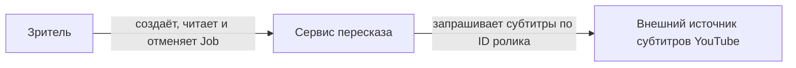
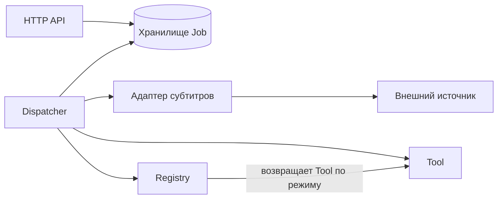
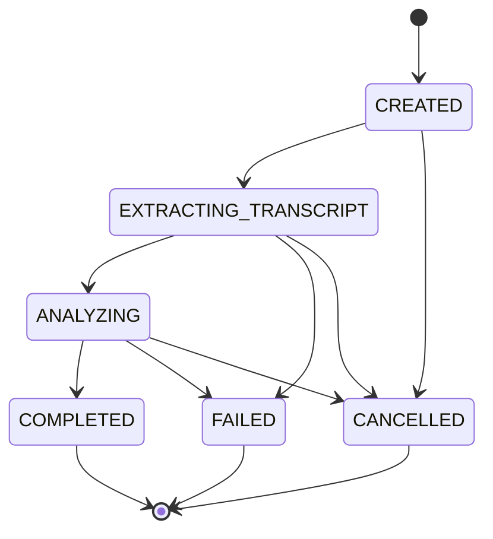

# Архитектура сервиса пересказа роликов

## Контекст

Стрелки показывают вызовы. Результаты и ошибки возвращаются по тем же каналам в обратную сторону.

## Компоненты

Стрелки показывают вызовы во время работы. Стрелка из Registry обозначает выдачу ссылки на исполнителя при вызове Dispatcher.

| Компонент | Ответственность | Что скрывает |
|---|---|---|
| HTTP API | Аутентифицирует клиента, проверяет запрос, создаёт, читает и отменяет Job | Разбор HTTP, отображение ошибок в коды ответа |
| Хранилище Job | Хранит состояния, результат, ключ идемпотентности и право обработки | Схему данных, транзакции и атомарную смену состояния |
| Dispatcher | Забирает Job, координирует получение субтитров и запуск Tool | Порядок обработки, продление права и проверку просроченных прав |
| Registry | Выбирает Tool по режиму | Список и регистрацию конкретных исполнителей |
| Tool | Получает нормализованные субтитры и формирует результат | Алгоритм выделения тезисов и группировки отрезков |
| Адаптер субтитров | Получает и нормализует субтитры по ID ролика | Формат внешнего ответа, таймаут и повторы запроса |

## Состояния Job

Стрелки между состояниями показывают разрешённые переходы. Все остальные переходы запрещены. Хранилище проверяет исходное состояние при записи, поэтому завершение и отмена не могут одновременно изменить одну Job.

- Отмена `COMPLETED` или `FAILED` возвращает `409 JOB_ALREADY_FINISHED`.
- Повторная отмена `CANCELLED` возвращает `200` с тем же состоянием.
- Попытка исполнителя записать результат в конечное состояние, перескочить этап или записать результат с просроченным правом отклоняется хранилищем. Клиент получает сохранённый статус через `GET /jobs/{id}`.
- Повторный запуск с новым ключом создаёт отдельную `CREATED` Job.

[Правила HTTP и восстановления](api-contract.md)
