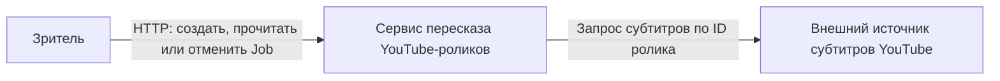
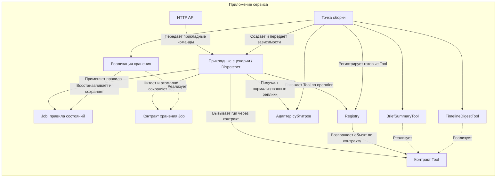
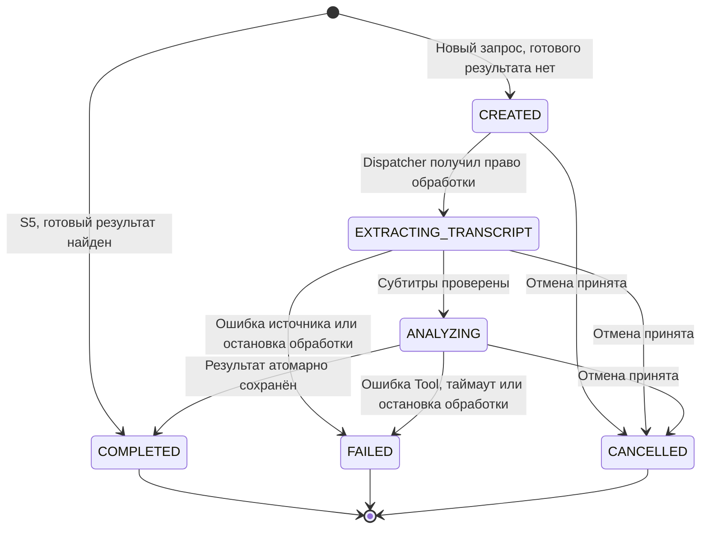

# Архитектура сервиса пересказа роликов

Документ покрывает пункты 1–2 практики 2 и опирается на [сценарии S1–S5](requirements.md). Внешний источник субтитров доступен через адаптер. Конкретного поставщика предстоит выбрать.

## Контекст

Стрелки показывают вызовы во время работы. Ответы с результатами и ошибками возвращаются по тем же каналам в обратную сторону. Хранение Job, обработка и кэш готовых результатов находятся внутри границы сервиса.

## Компоненты

Стрелки показывают зависимости кода. Сплошные стрелки означают использование компонента или контракта, пунктирные — реализацию контракта. Внешний HTTP-вызов к источнику показан на схеме контекста.

HTTP API передаёт создание, чтение и отмену прикладным сценариям. Dispatcher координирует фоновое выполнение. Эти сценарии используют общие правила Job и контракт хранения. Реализация хранения обращается к постоянному хранилищу, а адаптер обращается к внешнему источнику. Выбор конкретной СУБД и размещение фонового исполнителя команда фиксирует отдельно.

Точка сборки создаёт два Tool, регистрирует их под ключами `brief` и `timeline` и передаёт зависимости сценариям. Dispatcher получает готовые зависимости и вызывает выбранный Tool через общий контракт. Реестр хранит готовые объекты. Данные отдельного запуска передаются аргументом `run(transcript)`.

| Компонент | Ответственность | Что скрывает от соседей |
|---|---|---|
| HTTP API | Аутентифицирует клиента, проверяет форму запроса и отображает результат прикладной команды в HTTP-ответ | HTTP, разбор URL, коды ответов и формат ошибок |
| Прикладные сценарии / Dispatcher | Координируют создание, чтение, отмену и выполнение Job, нормализацию ID ролика, поиск готового результата и вызов Tool | Порядок шагов, проверку прав клиента, управление правом обработки и восстановление после остановки |
| Job | Определяет допустимые переходы, условия завершения и связь результата с заданием | Правила изменения состояния и проверку конечного состояния |
| Контракт хранения Job | Задаёт чтение, поиск готового результата, получение права обработки и атомарное сохранение перехода | Способ доступа к данным за предметными операциями сценария |
| Реализация хранения | Загружает Job и сохраняет переход с проверкой исходного состояния, версии и права обработки в одной атомарной операции | Схему данных, запросы, индексы кэша и механизм транзакций |
| Registry | Возвращает зарегистрированный Tool по режиму `brief` или `timeline` | Таблицу соответствия режима объекту и проверку уникальности регистрации |
| Контракт Tool | Определяет вход, результат, ошибки и обязанности по проверке параметров | Детали алгоритмов конкретных исполнителей |
| BriefSummaryTool | Возвращает непустой список тезисов по общему контракту Tool | Алгоритм выделения тезисов из субтитров |
| TimelineDigestTool | Возвращает упорядоченные отрезки с таймкодами и тезисами по общему контракту Tool | Алгоритм группировки реплик и построения таймлайна |
| Адаптер субтитров | Получает, проверяет и нормализует субтитры по ID ролика, преобразует ошибки источника в ошибки приложения | HTTP, авторизацию и формат поставщика, таймауты и повторную попытку |
| Точка сборки | Создаёт конкретные реализации и передаёт их сценариям | Конструкторы, настройку и время жизни зависимостей |

Контракт исполнителей описан в [tool-contract.md](tool-contract.md). Tool возвращает результат или ошибку. Dispatcher применяет правила Job, затем сохраняет переход через контракт хранения.

Правила Job проверяются при каждом прикладном вызове независимо от HTTP. Проверка объекта и атомарная запись вместе защищают от параллельного завершения и отмены. Контракт хранения должен предоставлять операции с этими гарантиями, включая конфликт версии, а реализация обеспечивать их средствами выбранного хранилища.

### Почему проведены эти границы

- Новый алгоритм пересказа меняет реализацию Tool и регистрацию при сборке. При сохранении контракта общий алгоритм Dispatcher остаётся прежним.
- Переименование поля в ответе поставщика меняет адаптер субтитров. Сценарии получают прежние нормализованные реплики и ошибки приложения.
- Изменение схемы хранения меняет реализацию хранения и миграции. Сценарии используют предметные операции контракта.
- Изменение правила перехода Job меняет Job и проверки сценариев. Реализация хранения продолжает обеспечивать атомарность записи.

Эти границы соответствуют разделению ответственности в лекции 103, слайды 17–20, 28–33, 47–52 и 60–62. Масштабы контекста системы и компонентов приложения разделены согласно слайду 78.

## Состояния Job

| Состояние | Значение |
|---|---|
| `CREATED` | Job сохранена и ожидает обработки |
| `EXTRACTING_TRANSCRIPT` | Выполняется получение субтитров |
| `ANALYZING` | Выбранный Tool анализирует субтитры |
| `COMPLETED` | Результат сохранён и доступен клиенту |
| `FAILED` | Сохранена причина сбоя, результат отсутствует |
| `CANCELLED` | Отмена сохранена, результат отсутствует |

Стрелки показывают создание Job и разрешённые переходы. Конечные стрелки обозначают завершение жизненного цикла. Job и её результат остаются доступны для чтения.

### Условия переходов

| Переход | Условие и наблюдаемый результат |
|---|---|
| Создание → `CREATED` | Новый ключ запроса, готового результата нет. Job сохраняется до ответа клиенту. По текущему API ответ `202` с ID и `CREATED`. |
| Создание → `COMPLETED` | S5, найден готовый результат по нормализованному ID ролика и режиму. Сохраняется новая Job с доступным результатом, адаптер и Tool не запускаются. HTTP-ответ для этого пути требует согласования с пунктом 3, см. ниже. |
| `CREATED` → `EXTRACTING_TRANSCRIPT` | Dispatcher атомарно получает право обработки и начинает получение субтитров. |
| `EXTRACTING_TRANSCRIPT` → `ANALYZING` | Адаптер вернул допустимые нормализованные реплики, Dispatcher выбрал Tool по режиму. |
| `ANALYZING` → `COMPLETED` | Результат сохраняется вместе с конечным статусом. Право обработки действует, отмена и таймаут ещё не зафиксированы. |
| `EXTRACTING_TRANSCRIPT` → `FAILED` | Сохраняется код ошибки источника, в том числе `TRANSCRIPT_TIMEOUT`, `TRANSCRIPT_UNAVAILABLE` или `TRANSCRIPT_INVALID_RESPONSE`. Tool не запускается. |
| `ANALYZING` → `FAILED` | Ошибка Tool даёт `ANALYSIS_FAILED`, превышение 60 секунд анализа — `ANALYSIS_TIMEOUT`. |
| Активная Job → `CANCELLED` | Отмена атомарно сохранена, API возвращает `200` с ID и `CANCELLED`. |
| `EXTRACTING_TRANSCRIPT` или `ANALYZING` → `FAILED` | Истекло право обработки, Dispatcher сохраняет `PROCESSING_INTERRUPTED`. |

Исполнитель получает право обработки на 60 секунд и продлевает его каждые 15 секунд. Dispatcher проверяет истечение права при старте и каждые 15 секунд. После перезапуска Job в `CREATED` остаются доступными для запуска. Терминальные Job сохраняют статус.

### Запрещённые переходы и гонки

Job отклоняет переходы, отсутствующие на диаграмме. Реализация хранения также проверяет, что состояние и версия не изменились между чтением и записью. Для уже существующей Job прямой переход `CREATED` → `COMPLETED` запрещён. Путь S5 создаёт новую Job сразу с готовым результатом.

| Попытка | Ответ системы |
|---|---|
| Отмена `COMPLETED` или `FAILED` | `409 JOB_ALREADY_FINISHED`, сохранённый статус и результат остаются доступными |
| Повторная отмена `CANCELLED` | `200` с ID и `CANCELLED`, новый переход не выполняется |
| Повторный запуск конечной Job | При новом ключе создаётся отдельная Job. Повтор исходного запроса с тем же ключом возвращает исходный ответ, см. правила API |
| Запоздавший ответ адаптера после отмены | Хранилище отклоняет переход в `ANALYZING`, Tool не запускается |
| Запоздавший результат Tool после отмены, сбоя или истечения времени анализа | Хранилище отклоняет запись результата, клиент видит сохранённое конечное состояние |
| Попытка исполнителя перескочить этап или записать переход с просроченным правом | Хранилище отклоняет запись, статус Job сохраняется. Внутренние переходы недоступны через публичный HTTP API |
| Отмена одновременно с завершением | Выигрывает первый атомарно сохранённый переход. При победе отмены результат отбрасывается. При победе завершения отмена получает `409 JOB_ALREADY_FINISHED` |

### Согласование S5 с контрактами

В [требованиях S5](requirements.md#s5-повторный-запрос-уже-обработанного-ролика) уже предусмотрена новая Job сразу в `COMPLETED`. В текущем [API-контракте](api-contract.md#создание-job) и [OpenAPI](api/openapi.yaml) создание описано только ответом `202` с `CREATED`. При доработке пункта 3 команде нужно согласовать HTTP-ответ для S5 и гарантировать, что доступ к результату из кэша проходит проверку прав клиента. Эта диаграмма отражает требование S5. Политика доступа и срок хранения кэша требуют решения команды.

[Полные правила ошибок и восстановления](api-contract.md#состояния-и-сбои)
